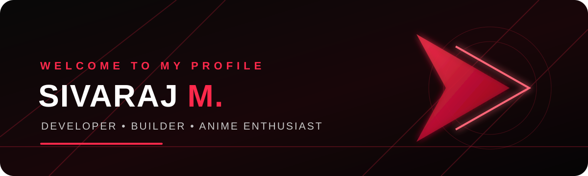

<!-- Premium red / black profile for Wisher5031 -->

 

 

---

## ⚡ About Me

> *“Dream it. Design it. Build it. Make it real.”*

- 👋 Hi, I'm **Sivaraj**.
- 💻 Interested in software, creative technology, and building useful digital experiences.
- 🎮 Inspired by games, anime aesthetics, and futuristic design.
- 🚀 Always exploring, learning, and turning ideas into projects.

## 🧩 What I'm Exploring

| 💻 Development | 🎨 Creative Tech | 🚀 Projects |
|:---:|:---:|:---:|
| Application ideas | UI / visual design | Practical tools |
| Web experiences | 3D-inspired visuals | Game concepts |
| Problem solving | Digital creativity | Learning by building |

## 🛠️ Tech & Tools

## 📊 GitHub Activity

  
  

  

## 🌌 Connect

  

**Thanks for visiting — keep creating, keep leveling up.** 🔴

